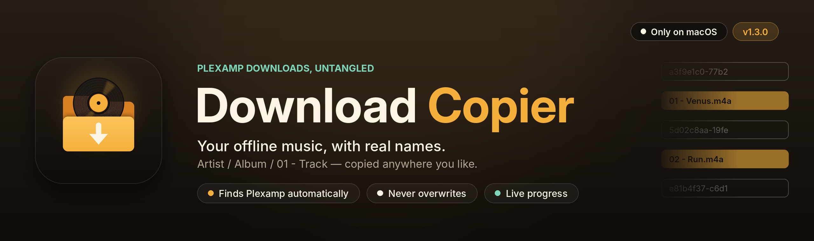

<p align="center"></p>

<p align="center">
  <a href="https://github.com/dustalexw/plickass/releases/tag/v1.3.0"></a>
  <a href="https://github.com/dustalexw/plickass/releases/download/v1.3.0/plickass-1.3.0-macOS.zip"></a>
  <a href="#download-the-macos-app"></a>
</p>

# plickass

Plexamp's offline downloads are stored as files named only by random IDs. **plickass**
turns them back into real music files, copied anywhere you like as `Artist / Album / 01 - Track`.

```
Find your Plexamp downloads → Choose a destination → Copy → Show in Finder
```

* **Finds your downloads automatically** and shows how many tracks, albums and artists are ready.
* **Never overwrites.** Files already in the destination are skipped, so you can run it again any time.
* **Read-only on the Plexamp side.** Your downloads are never moved or changed.
* **Live progress** with every copied track listed as it happens.

Choose **plickass → About plickass** for the version, a feature overview
and links to the source.

## Download the macOS app

Download **plickass-1.3.0-macOS.zip** from the [1.3.0 release](https://github.com/dustalexw/plickass/releases/tag/v1.3.0), unzip it and move **plickass.app**
to Applications. It runs on macOS 11 or later, on Apple silicon and Intel.

* **Python 3** does the copying. Most Macs already have it through Apple's Command Line Tools; if plickass
  says it can't find Python, run `xcode-select --install` in Terminal or install it from
  [python.org](https://www.python.org/downloads/macos/).
* The app isn't signed or notarized by Apple, so macOS blocks the first launch. Open **System Settings →
  Privacy & Security**, scroll down and click **Open Anyway** next to plickass (or right-click the app and
  choose **Open**). After that it opens normally.

## The script

plickass is built on [Plexamp Download Copier](https://github.com/danrahn/Plexamp-Download-Copier) by Daniel Rahn, whose command-line script does the copying. The script copies downloaded music from Plexamp to a location of your choice.

When you download music in plexamp, it is given a random guid as a filename with no extension, making it impossible to know at a glance what each file corresponds to. However, each download folder also includes an `index.json` that contains the metadata for all the items, which can be used to correlate the guid to the right track.

After correlating each file to its underlying track, the script will copy them to a new location with the following hierarchy:

```
Root\
  Artist1\
    Album1\
      01 - Track1.mp3
      02 - Track2.m4a
    Album2\
  Artist2\
    Album1\
  ...
```

## Requirements

Python 3. If running `python` defaults to Python 2, use `python3` or `py -3` (depending on your platform) to invoke the script instead.

## Usage

```
python plexampDownloadCopier.py [-d dir]

  -d dir - Full path to copy the music to. If not provided, the script will ask for a location. If the path does not exist, the script will ask before creating it.
```

## Notes

This script was tested on Windows and Ubuntu, but should work on other platforms. Regardless, the worst that should happen is the script not automatically finding the PlexAmp download directory, in which case it will interactively ask the user to supply that location.

## Mac app (GUI)

Double-click **plickass.app**. It finds your Plexamp downloads folder automatically (or click **Browse…**), lets you pick a destination, and shows progress while it copies. You can drag it into `/Applications`; it carries its own copy of the scripts.

- The window is a native macOS window (`app.js`, run by macOS's built-in JavaScript for Automation), so no Tk or extra packages are needed. The copying is done by any Python 3 on your Mac (Homebrew, python.org, or Apple's Command Line Tools).
- After editing `app.js`, `copy_runner.py`, `correlate.py` or `plexampDownloadCopier.py`, double-click `build.command` (or run `./build.command`) to rebuild and open the app. `VERSION` sets the version number.
- If something goes wrong, check `~/Library/Logs/plickass.log`.

`gui.py` is a cross-platform Tk version (`python3 gui.py`). It needs Tk 8.6 or newer: Apple's built-in Python ships Tk 8.5, which draws a blank window on recent macOS.
